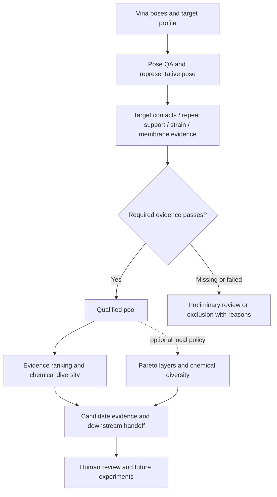

# Yuanhe Screening | 元核虚拟筛选

**Evidence-led candidate prioritization for structure-based drug discovery.**

Turn Vina poses and engine-labelled historical GNINA poses into reviewable candidate decisions: what passed, what failed, what remains unknown, and what should receive the next calculation or experiment. The internal package and CLI remain `zvss` (historically Zhiyu Virtual Screening Studio); existing commands and imports are preserved.

## What this module contributes

| Research question | Existing implementation | Output / boundary |
|---|---|---|
| Is the pose chemically and geometrically usable? | Pose QA and evidence tiers | Failures and flags remain visible; high affinity cannot replace QA |
| Does it occupy the intended region? | Target-region contacts and mechanism evidence | Contact is a geometric observation, not demonstrated inhibition |
| Is the docking result repeatable? | Seed-based redocking and qualification | Repeated runs of one engine are not independent affinity measurements |
| Is the conformation strained? | Strain assessment and exclusion | Force-field estimate; warning differs from failure |
| Is the membrane context supported? | Orientation evidence / explicit proxy status | Geometric proxy alone cannot establish membrane biology |
| Which candidates deserve a limited follow-up budget? | Qualification, evidence score and diversity | Formal, preliminary and exploratory lists remain distinct |
| Can another researcher review the decision? | Versioned selection, exclusions and report exports | Preserves evidence; does not establish biological activity |



## Screening-policy revision: local development

The `screening-evidence/v2` revision corrects missing-strain handling, prioritizes pose QA when choosing a representative, checks that strain/redocking evidence belongs to that pose, and separates strain warnings from blocking failures. The default selection strategy remains `evidence_diversity`. `pareto_diversity` is opt-in and is **not** validated as scientifically superior.

New report contracts include `decision.json` and `candidate_evidence.csv`: objective completeness, formal versus eligible Pareto membership, evidence coverage and fixed-pool weight sensitivity. These are source-level additions; this documentation-only acceptance pass has not generated or verified a new scientific report. Weight sensitivity is not calibrated predictive uncertainty.

See [policy details](docs/SCREENING_DECISION_V2.md), [implementation status](../docs/product/IMPLEMENTATION_STATUS.md) and [product positioning](../docs/product/PRODUCT_VALUE_ZH.md).

## Y-MAVS membrane-aware engine

Targets with `screening_mode: membrane_aware` additionally run the Yuanhe
Membrane-Aware Virtual Screening Engine: membrane regions, ligand-defined pocket
analysis, static geometric accessibility, compatibility descriptors, optional
multi-state evidence and an evidence-first ranking. GNINA scores, baseline ranks and
formal qualification remain separate and are never upgraded by a proxy membrane plane.

See [Y-MAVS implementation and validation boundary](docs/YMAVS.md) and the generic
[target template](configs/targets/membrane_protein_template.yaml). The archived 1DRF
fixture was executed once as a proxy-only integration check; no new docking, MD or
benchmark is claimed.

## Existing entry points

Install into the chemistry environment from the repository root with `python -m pip install -e ./03_virtual_screening`. From this module directory, existing commands are:

```bash
zvss --root . doctor --with-tools
zvss --root . run --input /path/to/vina/results --target configs/targets/ecmurj.yaml --budget configs/budgets/quick.yaml
zvss --root . serve --port 8770
zvss --root . report --run-id YOUR_RUN_ID
zvss --root . runs
```

These commands are reference instructions, not executed as part of the current organization task. `--root` is global and precedes the subcommand. The standalone web view is read-only; integrated execution remains in the main workbench. Do not launch a new run against an active or historical run directory.

## Source navigation

`src/zvss/` contains ingestion, receptor audit, quality control, mechanism, motion, redocking, scoring, strain, selection, membrane proxy, handoff and reporting. `select/qualify.py` defines formal qualification; `select/pipeline.py` defines candidate allocation; `scoring/aggregate.py` defines representative poses and scoring. Target profiles live in `configs/targets/`, budgets in `configs/budgets/`, and policy choices in `configs/stages*.yaml`.

Missing dependencies produce explicit blocked/unsupported states. Use an ASCII scratch directory for RDKit/PoseBusters where necessary. For the exact 9NU4 construct, screening can transfer the archived PPM3 orientation after hash, mapping and rigid-fit checks. Other inputs retain proxy or missing-evidence status. This screening orientation check does not build a membrane or establish experimental orientation. MurJ pose-level conclusions require real target poses. See the architecture, interface and historical acceptance records for details.
Each run stores resolved configuration, logs, stage summaries and reports. Databases and generated outputs are not committed. Historical t4/t5 runs imported 60 poses from 20 compounds and produced identical selection/ranking files; this does not validate MurJ docking or the new policy. Older primary labels must not be read as passing current qualification rules.

## Integration and limits

Official Vina 1.2.7 is the production docking engine; this module supplies the screening decision layer. Standalone OpenMM and ZLIS consume explicit file contracts; the workbench provides a separate membrane/GROMACS path. Missing dependencies yield blocked/unsupported states. Use an ASCII scratch directory for RDKit/PoseBusters when needed. The membrane module's proxy is not a built membrane or experimentally sourced orientation.

No claim is made that these candidates are active drugs, that this is autonomous discovery, or that the workflow outperforms other screening platforms. Model training, ADMET prediction, prospective hit-rate improvement and a validated active-learning loop are outside the current demonstrated scope.

New Vina scores use `vina_affinity_kcal_mol`, lower is better. CNN components are not applicable and are omitted from Vina ranking weights. Mixed-engine rankings are refused. For independent redocking install the sibling `02_docking` package (`local-sbvs`) as well as this module; the exported screening package includes it as `docking_backend/`. See [research migration](../docs/15_VINA_RESP_RESEARCH.md).
