# 🧬 Yuanhe Bio

**AI-Driven Drug Discovery & Molecular Design Platform**

*From Protein Structures to Small-Molecule Candidates.*

Generative AI · Structure-Based Drug Design · Virtual Screening · Molecular Dynamics

**Source-Available Research Edition · 0.4.0-rc1 · Final acceptance open**

Yuanhe Bio brings molecular generation, docking and evidence-led candidate review into a traceable AIDD research workflow. Its current product focus is helping researchers decide which computational hypotheses merit further review and testing.

[Screening decision layer](03_virtual_screening/README.md) · [Product value and commercial positioning](docs/product/PRODUCT_VALUE_ZH.md) · [Code and documentation map](docs/product/CODE_AND_CONTENT_MAP.md) · [Public/private boundary](docs/commercialization/public_private_boundary.md)

## Current source migration: Vina and single-trajectory research MD

New tasks use official **AutoDock Vina 1.2.7** on CPU, chemistry-preserving Meeko
preparation/export, Vina affinity in kcal/mol (lower is better), and no CNN model
or GNINA fallback. MD defaults to **GAFF2 + HF/RESP, one 500 ns trajectory per
selected complex**, with core RMSD statistics and actual MM/PBSA at 400–500 ns.
OpenMM and the explicit-membrane GROMACS path remain separate supported entrypoints.

This revision is **code/configuration/documentation delivery only** at the owner's
request. No runtime acceptance is claimed; task-generated acceptance outputs were
deleted. The administrator deploys this GitHub source and provides the workbench UI URL; users operate that page manually or with Codex. Historical release
records below do not certify this migration. Public demo source is updated; a live
website deployment is not part of this delivery.

[Use the administrator-provided UI link](docs/18_UI_RESEARCH_WORKFLOW.md) ·
[Migration and methods](docs/15_VINA_RESP_RESEARCH.md) ·
[Dependency licenses](docs/16_RESEARCH_DEPENDENCY_LICENSES.md)

## Research workflow and current evidence

A research workbench for molecular generation, structure-based virtual screening and membrane-protein modeling. Connect Peptide2Mol, REINVENT4, AutoDock Vina and molecular dynamics through reviewed inputs, traceable file handoffs and a local browser interface.

[Quick start](#start) · [Installation](docs/01_SETUP.md) · [Supported platforms](docs/12_SUPPORT_MATRIX.md) · [Validation evidence](docs/10_INTEGRATED_ACCEPTANCE.md) · [Questions and ideas](https://github.com/lzylumos-sudo/yuanhe-bio-workflow/discussions)

## What you can use it for

- **Review and prioritize docking results:** import Vina outputs and engine-labelled historical GNINA outputs, inspect pose quality, apply candidate qualification rules and export traceable selections.
- **Connect molecular design stages:** review molecular cores, generate candidates through external model adapters, and preserve the relationship between structures, molecules and poses.
- **Investigate membrane-protein workflows:** examine membrane orientation evidence, prepare reviewed membrane systems and connect screening to downstream dynamics. MurJ / 9NU4 is the recorded reference case; other targets need their own configuration and validation.
- **Reuse individual components:** use docking, screening, interaction analysis or standalone OpenMM modules without adopting the entire workbench.

The project's contribution is workflow integration, review checkpoints and evidence tracking. The underlying generation, docking and simulation methods belong to their respective upstream projects. This is research software with a noncommercial source-available license; it is not a validated predictor of binding affinity or biological activity.

## Historical release evidence (before this migration)

**Release 0.4.0-rc1: reproducible research integration, with explicit scientific gates.** The browser workflow connects reviewed structures to generation, docking, screening, membrane construction, GROMACS, trajectory analysis and export. The fresh 9NU4 run completed all 16 generation attempts (one accepted), generated eight unique REINVENT molecules and docked nine molecules / 81 poses. Corrected, versioned reassessment of the archived three-seed redocking results yielded **two formally qualified screening candidates**. Qualification is distinct from MD quality and biological activity.

The release includes independent docking, screening, membrane MD and peptide-contact evidence packages, clean-environment installation records, a second-target crystallographic docking control, and prespecified three-repeat MD quality criteria. See [current acceptance evidence](docs/10_INTEGRATED_ACCEPTANCE.md), [module contracts](docs/07_MODULE_CONTRACTS.md) and [application scope](docs/09_MATURITY_AND_APPLICATION_SCOPE.md). Prior 0.3 results remain historical records. Windows/WSL2 with RTX 5070 is not a validated execution platform for this release.

**Final acceptance remains open.** The last remote observation on 2026-10-18 at 11:18 China Standard Time confirmed two completed 5 ns repeats; the third was in equilibration. Remote access was lost before aggregate acceptance and final export. Passing automated checks does not close those steps. The [five-part acceptance and maintenance checklist](docs/11_RELEASE_MAINTENANCE.md) defines the remaining scope, evidence requirements and release decision.

```mermaid
flowchart LR
 A[Complex and construct review] --> B[Peptide2Mol seeds]
 B --> C[Interactive core review]
 C --> D[REINVENT4 expansion]
 D --> E[AutoDock Vina CPU docking]
 E --> F[Virtual screening]
 F --> G[Candidate and membrane review]
 G --> H[Build membrane system]
 H --> I[GROMACS and checkpoint recovery]
 I --> J[Trajectory analysis and export]
```

| Directory | Purpose |
|---|---|
| `00_workbench` | Unified UI, guided review, scheduling, membrane builder, GROMACS and analysis |
| `01_molecule_generation` | Preparation, model adapters, core and chemistry checks |
| `02_docking` | Official Vina protocols, docking records and standalone tools |
| `03_virtual_screening` | Pose QC, evidence, diversity, qualification and ranking |
| `04_interaction_analysis` | Optional ZLIS interaction visualization |
| `05_molecular_dynamics` | Optional standalone OpenMM workflow |
| `data/structures` | Original structural inputs and provenance |
| `deployment` | Installation, runtime configuration and validation tools |
| `docs` | Architecture, setup and validation records |
| `archive` | Historical docking prototype |

## Quick Start

For a deployed installation, open the **workbench UI URL supplied by the
administrator**. Create a run, review inputs and parameters, start or resume the
selected system, inspect analysis and export records through that page. You can
operate it manually or ask Codex to operate the same UI. No separate client-side
compute installation or launch entry is required. See the
[UI workflow](docs/18_UI_RESEARCH_WORKFLOW.md).

Administrators deploy from GitHub and configure environments, data paths and GPU
access using the existing [setup documentation](docs/01_SETUP.md). The public
static demo is distinct from the deployed research workbench.

- [Setup](docs/01_SETUP.md)
- [Platform support and test commands](docs/12_SUPPORT_MATRIX.md)
- [Changelog](CHANGELOG.md)
- [Contributing](CONTRIBUTING.md)
- [UI workflow](USER_GUIDE.txt)
- [RTX 5070 installation and MurJ validation](deployment/validation_5070/INSTALL_AND_VALIDATE.txt)
- [Architecture](docs/02_PROJECT_GUIDE.md)
- [Validation scope](docs/04_VALIDATION.md)
- [Third-party sources](THIRD_PARTY_NOTICES.md)

## Scientific boundaries

The current input is MurJ / 9NU4. Review chains, construct mutations, residue ranges, protonation and the docking box. Peptide2Mol uses the peptide-defined receptor pocket; explicit peptide-pharmacophore retention is not claimed. REINVENT4 expands a reviewed molecular core, not a protein backbone.

Counts distinguish requested samples, valid unique molecules, docking poses, preliminary candidates and formally qualified candidates. Unperformed checks never become passes. For the exact 9NU4 construct, screening transfers an archived PPM3 orientation with file hashes, atom mapping and a rigid-fit tolerance check. Other structures without matching evidence retain a proxy or missing-evidence status; the membrane builder requires a reviewed orientation. Idealized single-lipid membranes are not full bacterial membrane models.

The built-in MD path includes parameterization, minimization, staged equilibration, production, checkpoint guards and analysis. It has not been executed on the target Windows machine in this release. Short trajectories and docking scores do not establish affinity, activity or convergence.

Weights, installed environments, VHDX images and historical run outputs are excluded from GitHub. Restore pinned models separately. An external disk does not remove host driver, WSL, environment or target-machine acceptance requirements.

## License

Original project contributions in this release use the unmodified [PolyForm Noncommercial License 1.0.0](LICENSE), subject to [scope and existing rights](LICENSE_SCOPE.txt). This is source-available software, not an unrestricted commercial-use open-source license. Commercial uses outside the license's permitted purposes require separate authorization. Third-party materials and prior grants retain their own terms; see [notices](THIRD_PARTY_NOTICES.txt).

## Use a component or contribute

| Your starting point | Entry point |
|---|---|
| Existing GNINA batch outputs | [Virtual screening commands and target configuration](03_virtual_screening/README.md) |
| Protein-ligand interaction inspection | [ZLIS analysis and visualization](04_interaction_analysis/README.md) |
| Standalone docking preparation | [Docking module](02_docking/README.md) |
| Standalone OpenMM simulation | [MD setup and scope](05_molecular_dynamics/README.md) |
| Integrated browser workflow | [User guide](USER_GUIDE.txt) and [environment reconstruction](docs/14_ENVIRONMENTS.md) |

Ask usage questions and propose collaborations in [Discussions](https://github.com/lzylumos-sudo/yuanhe-bio-workflow/discussions). Report reproducible defects or concrete feature requests through [Issues](https://github.com/lzylumos-sudo/yuanhe-bio-workflow/issues/new/choose). Contributions that improve reproducible examples, installation evidence and target-specific validation are welcome; see [CONTRIBUTING.md](CONTRIBUTING.md). Share only inputs and outputs you have permission to publish.

## Cite and acknowledge

If you use this workflow, identify the repository URL and exact commit or release in your methods. GitHub's **Cite this repository** entry provides software citation metadata from [CITATION.cff](CITATION.cff). Also cite the upstream methods you actually used, following [third-party notices](THIRD_PARTY_NOTICES.md). Repository citation does not substitute for those method citations or imply upstream endorsement.

## Why use Yuanhe Bio?

- **Review candidates, not just score tables.** Pose quality, target contacts, repeat support, strain and membrane evidence feed explicit qualification and exclusions.
- **Preserve scientific context.** Candidate, pose, configuration and downstream handoff identities remain traceable.
- **Keep review in the workflow.** Structure preparation, core choice, membrane orientation and experimental decisions require human judgment.

The screening decision layer is project-authored engineering built around established scientific methods. It is not a claim to have invented docking, Pareto optimization or the upstream generative models. Measured time savings, improved hit rates and multi-target superiority remain to be demonstrated.

## Development priorities

1. Candidate evidence and reproducible review: complete acceptance and compare against a score-only baseline.
2. Target-specific screening protocols: validate beyond MurJ with independent targets and controls.
3. Experimental-feedback optimization: design and evaluate multi-objective active learning before product claims.

See the [18-month, evidence-gated roadmap](docs/product/ROADMAP.md). The local screening-policy revision has not completed release acceptance; it does not revise historical results.

## Collaboration & commercial use

We welcome method evaluation and research collaboration around reproducible, target-specific candidate prioritization. Discuss public, nonsensitive questions through [GitHub Issues](https://github.com/lzylumos-sudo/yuanhe-bio-workflow/issues). Arrange a private channel before sharing unpublished structures, molecules or customer data. No commercial service-level agreement or validated efficacy is currently offered.

Public visibility does not grant unrestricted commercial use. Commercial deployment requires review of original-code rights, prior grants, dependency code, model weights and data terms. See the unchanged license documents above and the [commercialization boundary](docs/commercialization/public_private_boundary.md).

Pre-docking substructure risk and acquisition gates (2026-10-21)
REINVENT4 → standardization and deduplication → risk → availability → AutoDock Vina. See docs/PREDOCKING_PREFLIGHT.md for configuration, real supplier catalog fields, local AiZynthFinder assets, review, caching and CLI instructions. Missing real evidence never grants automatic passage; the pre-docking integration does not change MD code or parameters.
