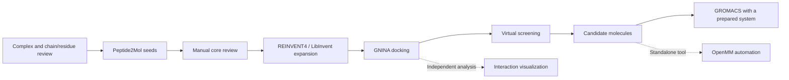

# Yuanhe Bio Workflow · 元核生物

**English** | [简体中文](README.zh-CN.md)

A research workflow for small-molecule design, docking, screening, and downstream simulation based on protein–peptide complexes. The project connects molecular design and analysis tools through traceable computational stages, supporting ongoing development, method review, and reproducible research.

**Current status: engineering integration candidate.** Stage execution and artifact checks are connected, but the complete target-specific workflow—from model inference through GNINA docking and screening to membrane molecular dynamics—has not yet been validated end to end. Test doubles do not establish real model inference, and historical computation records do not validate the current code revision.

## Workflow and repository structure



| Order | Directory | Purpose |
|---|---|---|
| 00 | `00_workbench/` | Unified web interface, stage scheduling, logs, artifacts, and failed-stage retries |
| 01 | `01_molecule_generation/` | Structure preparation, Peptide2Mol / REINVENT4 adapters, chemistry checks, and core validation |
| 02 | `02_docking/` | Main GNINA adapter, docking protocols, and task and result records |
| 03 | `03_virtual_screening/` | Pose import, quality control, identity tracking, diversity analysis, and candidate ranking |
| 04 | `04_interaction_analysis/` | Standalone ZLIS interaction analysis and visualization |
| 05 | `05_molecular_dynamics/` | Standalone OpenMM automation; does not prepare membrane systems for GROMACS |
| — | `data/structures/` | Centralized PDB inputs and provenance manifest |
| — | `deployment/` | Environment checks, configuration templates, and third-party dependency restoration |
| — | `docs/` | Setup, architecture guide, validation records, and path migration mapping |
| — | `archive/docking_prototype/` | Earlier standalone docking prototype, not used as the main workflow backend |

The numeric prefixes indicate the reading and working order; modules 04 and 05 are optional downstream tools. The GROMACS execution adapter is in `00_workbench/pipeline_bridge.py`.

## Quick preview

With Python 3.11 or later, run from the repository root:

```bash
python3 00_workbench/run_webui.py --no-browser
# Open http://127.0.0.1:8777 in your browser.
```

Starting the web interface does not launch scientific calculations. On Linux/WSL, you can also run `bash start_linux.sh`. On Windows, use `start_windows.cmd` and select an existing WSL distribution.

Before running calculations, read [Setup and configuration](docs/01_SETUP.md) and configure your local `deployment/runtime.json`. Models, weights, GNINA, GROMACS, and scientific computing environments must be installed separately. Missing dependencies must block the relevant stage rather than produce substitute results.

## Project documentation

The detailed documents below are currently primarily in Chinese.

1. [Project scope and contributions](docs/02_PROJECT_GUIDE.md)
2. [Naming and migration rules](docs/03_MIGRATION.md) / [File mapping](docs/FILE_MAP.csv)
3. [Validation record](docs/04_VALIDATION.md)
4. [Third-party sources](THIRD_PARTY_NOTICES.md)

This repository contains code, configurations, tests, and small structural examples. It excludes model weights, WSL images, Conda environments, trajectories, historical run outputs, full-text papers, private configurations, and tokens.

## Scope and limitations

- The main workflow retains both the full receptor and the model input pocket, and checks artifact hashes between stages. Molecular cores, docking receptors and boxes, and membrane systems require review.
- The GROMACS entry point executes an already prepared TPR. Automated membrane system construction, ligand parameterization, and comprehensive trajectory analysis are not yet implemented in this workflow.
- The OpenMM module and historical tests have their own scope; they do not validate GROMACS execution or operation on a new platform.
- Candidate rankings, computational scores, and simulation results do not constitute experimental evidence of activity, affinity, or mechanism.
- Historical documents describe earlier development work and may reference data not included in this repository or previous machines. Use this README and `docs/01_SETUP.md` for current entry points.

## Usage and licensing

This repository does not yet have a unified project-level open-source license. Public access does not grant unrestricted redistribution rights. Existing component license declarations and third-party licenses remain applicable. The team will specify the licensing scope of its original code separately; third-party software and model weights retain their original attribution and ownership.
