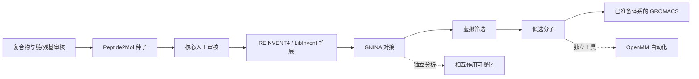

# 元核生物 · Yuanhe Bio Workflow

面向蛋白–多肽复合物的小分子设计、对接、筛选与后续模拟的研究工作流。本项目将分子设计与下游分析工具组织为可追溯的研究流程，支持持续开发、方法审查与计算复现。

**当前版本：工程集成候选版。** 已连接阶段执行与产物检查；完整目标模型推理 → GNINA → 筛选 → 膜动力学链路尚未完成实测。测试替身不代表真实模型推理，历史计算记录不代表本次代码验证。

## 主流程与阅读顺序



| 顺序 | 目录 | 作用 |
|---|---|---|
| 00 | `00_workbench/` | 统一网页、阶段调度、日志、产物与失败重试 |
| 01 | `01_molecule_generation/` | 结构准备、Peptide2Mol / REINVENT4 适配、化学与核心检查 |
| 02 | `02_docking/` | 主 GNINA 适配器、对接协议、任务与结果记录 |
| 03 | `03_virtual_screening/` | 位姿导入、质检、身份绑定、多样性与候选排序 |
| 04 | `04_interaction_analysis/` | 独立 ZLIS 相互作用分析与可视化工具 |
| 05 | `05_molecular_dynamics/` | 独立 OpenMM 自动化模块；不是 GROMACS 膜准备模块 |
| — | `data/structures/` | 集中保存的 PDB 输入与来源清单 |
| — | `deployment/` | 环境检查、配置模板、第三方依赖恢复 |
| — | `docs/` | 安装、项目架构指南、验证记录、新旧路径对照 |
| — | `archive/docking_prototype/` | 早期独立对接原型，不作为主流程后端 |

数字表示阅读/工作顺序；04 与 05 是可选下游工具。GROMACS 执行适配器位于 `00_workbench/pipeline_bridge.py`。

## 快速查看

Python 3.11+，从仓库根目录运行：

```bash
python3 00_workbench/run_webui.py --no-browser
# 浏览器打开 http://127.0.0.1:8777
```

仅启动网页不触发科学计算。Linux/WSL 也可运行 `bash start_linux.sh`；Windows 使用 `start_windows.cmd` 并选择已安装的 WSL 发行版。

实际计算前阅读 [安装与配置](docs/01_SETUP.md)，填写本机 `deployment/runtime.json`。模型、权重、GNINA、GROMACS 和科学计算环境均须另行安装。缺少依赖时阶段必须明确阻塞，不能产生替代结果。

## 项目文档

1. [项目与贡献边界](docs/02_PROJECT_GUIDE.md)
2. [重命名与迁移规则](docs/03_MIGRATION.md) / [逐文件对照](docs/FILE_MAP.csv)
3. [本次验证](docs/04_VALIDATION.md)
4. [第三方来源](THIRD_PARTY_NOTICES.md)

提交的是代码、配置、测试与小型结构示例；不包含模型权重、WSL 镜像、Conda 环境、轨迹、旧运行结果、论文全文、私人配置或令牌。原外置盘目录不被修改。

## 能力边界

- 主流程保留完整受体与模型口袋，阶段间检查文件哈希；核心、对接受体/盒、膜体系需审核。
- GROMACS 入口只执行已经准备好的 TPR，尚无自动膜体系构建、配体参数化与完整轨迹分析。
- OpenMM 模块与历史测试有自己的适用范围，不能替代 GROMACS 或新平台实测。
- 候选排序、分数与模拟结果不是实验药效、亲和力或机制证明。
- 历史文档为建设过程记录，可能引用未随仓库发布的数据或旧机器；当前入口以本 README 和 `docs/01_SETUP.md` 为准。

## 使用与授权

本仓库尚未采用统一的项目级开源许可证。公开访问不等于授予任意再分发权；已有组件的授权声明与第三方许可证继续适用。团队原创代码的授权范围由团队另行明确，第三方软件与模型权重保留其原有归属。
