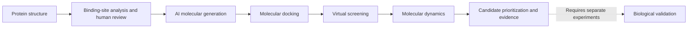

# 🧬 Yuanhe Bio | &#20803;&#26680;&#29983;&#29289;

### AI-Driven Drug Discovery & Molecular Design Platform

*From Protein Structures to Small-Molecule Candidates.*

A source-available **Artificial Intelligence for Drug Discovery (AIDD)** research workflow that connects reviewed protein structures, AI molecular generation, structure-based virtual screening and molecular dynamics with traceable evidence.

**Generative AI · Structure-Based Drug Design · Virtual Screening · Molecular Dynamics · Reproducible Workflow**

[](docs/10_INTEGRATED_ACCEPTANCE.md)
[](LICENSE)

**Release 0.4.0-rc1 — final acceptance remains open.** Yuanhe Research Edition is the current research direction; Yuanhe Enterprise is a proposed commercial platform, not an available enterprise product. Computational candidates are hypotheses for further testing.

## Workflow overview



The implemented path uses Peptide2Mol seeds, human-reviewed cores, REINVENT4 expansion, GNINA docking, screening and membrane/GROMACS execution. Structure interpretation, core selection, membrane construction choices and scientific acceptance require human judgment. Final repeated-MD acceptance is pending; biological validation is outside the demonstrated workflow.

## Core capabilities

| Capability | What it provides | Evidence boundary |
|---|---|---|
| AI molecular generation | Pinned Peptide2Mol and REINVENT4 adapters, sample accounting and chemistry checks | Real bounded inference recorded; no proprietary generator or proven functional mimicry |
| Structure-based drug design | Receptor/pocket preparation, core review and GNINA docking | MurJ example and a separate 1DRF docking control |
| Virtual screening | Pose quality, redocking, diversity, qualification and candidate identity | Qualification is a computational protocol verdict |
| Molecular dynamics | Membrane setup, GROMACS, checkpoint recovery and trajectory analysis | Two 5 ns repeats last observed complete; aggregate acceptance pending |
| Reproducible workflow | Source/input hashes, review gates, isolated execution and export implementation | Final UI export for the current acceptance run remains pending |
| Optional analysis | ZLIS interaction analysis and a separate OpenMM module | Separate environments and validation records |

## MurJ / 9NU4 research case

The recorded Linux / RTX 5090 D run completed 16 Peptide2Mol attempts (1 accepted), produced 8 unique REINVENT molecules and docked 9 molecules / 81 poses. Corrected reassessment of archived three-seed redocking results qualified **2 screening candidates**. These are computational candidates, not experimentally validated hits.

Peptide-contact comparison found that each of the seven shortlisted molecules recovered only **1 of 22** reference contact residues. Contact-guided sorting did not change the ordering. This negative result does not support peptide-function replacement or improved hit rate.

At the last remote observation on 2026-10-18 at 11:18 China Standard Time, two 5 ns MD velocity repeats were complete and the third was in equilibration. Remote access was lost before aggregate acceptance and final export. See the [integrated evidence and remaining gates](docs/10_INTEGRATED_ACCEPTANCE.md).

## Quick Start

For a local UI preview with Python 3.11+:

```bash
git clone https://github.com/lzylumos-sudo/yuanhe-bio-workflow.git
cd yuanhe-bio-workflow
python3 00_workbench/run_webui.py --no-browser
```

Open the displayed address, normally http://127.0.0.1:8777. Preview starts the interface; scientific engines and weights require separate installation. Follow [setup](docs/01_SETUP.md) and the [platform support matrix](docs/12_SUPPORT_MATRIX.md) before executing a calculation.

After dependency setup, Linux users can run `bash start_linux.sh`; Windows users can launch `start_windows.cmd` and choose the configured WSL distribution. Windows/WSL2 RTX 5070 acceptance is unverified. macOS supports preview and documented checks; use the Linux GPU execution path for the released model adapter.

## Documentation

| Start here | Contents |
|---|---|
| [Setup](docs/01_SETUP.md) · [UI guide](USER_GUIDE.txt) | Installation and reviewed execution |
| [Project guide](docs/02_PROJECT_GUIDE.md) · [Module contracts](docs/07_MODULE_CONTRACTS.md) | Architecture, data flow and handoff |
| [Validation](docs/04_VALIDATION.md) · [Integrated acceptance](docs/10_INTEGRATED_ACCEPTANCE.md) | Recorded checks and scientific limitations |
| [Release checklist](docs/11_RELEASE_MAINTENANCE.md) · [Platform support](docs/12_SUPPORT_MATRIX.md) | Open acceptance and supported paths |
| [Commercialization dossier](docs/commercialization/README.md) | Repository/rights audit, boundaries and proposed roadmap |
| [Changelog](CHANGELOG.md) · [Contributing](CONTRIBUTING.md) | Release history and contributions |
| [RTX 5070 installation recipe](deployment/validation_5070/INSTALL_AND_VALIDATE.txt) | Planned target setup; not proof of target execution |

The source is organized as `00_workbench`, `01_molecule_generation`, `02_docking`, `03_virtual_screening`, `04_interaction_analysis` and `05_molecular_dynamics`. `data/structures` preserves structural provenance; `deployment` supplies installation and packaging tools; `archive` retains the historical docking prototype.

## Validation & limitations

Review construct mutations, chains, residue ranges, protonation and the docking box. Peptide2Mol uses a peptide-defined receptor pocket; explicit pharmacophore retention is not established. REINVENT4 expands reviewed molecular cores, not protein backbones.

The 9NU4 membrane orientation is transferred from a hash-checked archived PPM3 result with atom mapping and a rigid-fit tolerance. Other constructs do not inherit that evidence. Idealized single-lipid membranes do not reproduce the complete bacterial membrane. Short MD, docking scores and passing software tests do not establish affinity, activity, convergence or clinical suitability.

Weights, environments, VHDX images and full historical run outputs are excluded. Restore pinned models separately and review their rights. The 1DRF control is not a second complete peptide-to-MD validation. No controlled time-saving study, broad target benchmark, wet-lab hit-rate improvement or paid-customer outcome is established. See [maturity assessment](docs/09_MATURITY_AND_APPLICATION_SCOPE.md).

## Roadmap

1. Close reproducibility and acceptance gaps, strengthen installation and independent benchmark evidence.
2. Evaluate structure constraints and multi-objective selection on held-out targets under fixed compute budgets.
3. Prototype uncertainty-aware active learning and separately deployed enterprise services only after rights, scientific and user-need gates.

These are development targets. See the [18-month plan](docs/commercialization/roadmap_18_months.md) and [closed-loop design](docs/commercialization/closed_loop_design.md).

## Licensing & commercial use

Original eligible contributions use the unmodified [PolyForm Noncommercial License 1.0.0](LICENSE), subject to [scope and existing rights](LICENSE_SCOPE.txt). This is **source-available research software**. A public repository does not grant unrestricted commercial authorization. Uses outside permitted purposes require separate permission from the relevant rights holders; the standard license controls.

Third-party code, weights, data and historical grants retain their own terms, including earlier MIT rights. A Yuanhe authorization cannot replace those rights or obligations. See [third-party sources](THIRD_PARTY_NOTICES.md), [preserved notices](THIRD_PARTY_NOTICES.txt) and the [preliminary license audit](docs/commercialization/license_audit.md).

## Collaboration & contact

We welcome reproducibility reports, public benchmark feedback and research collaboration. Use [GitHub Issues](https://github.com/lzylumos-sudo/yuanhe-bio-workflow/issues) for non-sensitive questions or to request a private contact channel for commercial licensing. Do not post confidential compounds, customer data or credentials in public issues.
