# Yuanhe Bio Workflow

A traceable research workbench connecting protein-peptide complexes to Peptide2Mol seeds, reviewed molecular cores, REINVENT4 expansion, GNINA docking, virtual screening and membrane molecular dynamics.

**Release 0.4.0-rc1: reproducible research integration, with explicit scientific gates.** The browser workflow connects reviewed structures to generation, docking, screening, membrane construction, GROMACS, trajectory analysis and export. The fresh 9NU4 run completed all 16 generation attempts (one accepted), generated eight unique REINVENT molecules and docked nine molecules / 81 poses. Corrected, versioned reassessment of the archived three-seed redocking results yielded **two formally qualified screening candidates**. Qualification is distinct from MD quality and biological activity.

The release includes independent docking, screening, membrane MD and peptide-contact evidence packages, clean-environment installation records, a second-target crystallographic docking control, and prespecified three-repeat MD quality criteria. See [current acceptance evidence](docs/10_INTEGRATED_ACCEPTANCE.md), [module contracts](docs/07_MODULE_CONTRACTS.md) and [application scope](docs/09_MATURITY_AND_APPLICATION_SCOPE.md). Prior 0.3 results remain historical records. Windows/WSL2 with RTX 5070 is not a validated execution platform for this release.

**Final acceptance remains open.** The last remote observation on 2026-10-18 at 11:18 China Standard Time confirmed two completed 5 ns repeats; the third was in equilibration. Remote access was lost before aggregate acceptance and final export. Passing automated checks does not close those steps. The [five-part acceptance and maintenance checklist](docs/11_RELEASE_MAINTENANCE.md) defines the remaining scope, evidence requirements and release decision.

```mermaid
flowchart LR
 A[Complex and construct review] --> B[Peptide2Mol seeds]
 B --> C[Interactive core review]
 C --> D[REINVENT4 expansion]
 D --> E[GNINA batch docking]
 E --> F[Virtual screening]
 F --> G[Candidate and membrane review]
 G --> H[Build membrane system]
 H --> I[GROMACS and checkpoint recovery]
 I --> J[Trajectory analysis and export]
```



| Directory | Purpose |
|---|---|
| `00_workbench` | Unified UI, guided review, scheduling, membrane builder, GROMACS and analysis |
| `01_molecule_generation` | Preparation, model adapters, core and chemistry checks |
| `02_docking` | GNINA protocols, docking records and standalone tools |
| `03_virtual_screening` | Pose QC, evidence, diversity, qualification and ranking |
| `04_interaction_analysis` | Optional ZLIS interaction visualization |
| `05_molecular_dynamics` | Optional standalone OpenMM workflow |
| `data/structures` | Original structural inputs and provenance |
| `deployment` | Installation, runtime configuration and validation tools |
| `docs` | Architecture, setup and validation records |
| `archive` | Historical docking prototype |

## Start

After initial dependency installation, double-click `start_windows.cmd` and select the configured WSL distribution. On Linux use `bash start_linux.sh`. For a UI-only preview with Python 3.11+, run:

```bash
python3 00_workbench/run_webui.py --no-browser
```

Open the displayed local address, normally http://127.0.0.1:8777. The UI starts without launching calculations. Configure environments once, then prepare, review, execute, stop, resume, inspect trajectories and export records through the interface.

- [Setup](docs/01_SETUP.md)
- [Platform support and test commands](docs/12_SUPPORT_MATRIX.md)
- [Changelog](CHANGELOG.md)
- [Contributing](CONTRIBUTING.md)
- [UI workflow](USER_GUIDE.txt)
- [RTX 5070 installation and MurJ validation](deployment/validation_5070/INSTALL_AND_VALIDATE.txt)
- [Architecture](docs/02_PROJECT_GUIDE.md)
- [Validation scope](docs/04_VALIDATION.md)
- [Third-party sources](THIRD_PARTY_NOTICES.md)

## Scientific boundaries

The current input is MurJ / 9NU4. Review chains, construct mutations, residue ranges, protonation and the docking box. Peptide2Mol uses the peptide-defined receptor pocket; explicit peptide-pharmacophore retention is not claimed. REINVENT4 expands a reviewed molecular core, not a protein backbone.

Counts distinguish requested samples, valid unique molecules, docking poses, preliminary candidates and formally qualified candidates. Unperformed checks never become passes. For the exact 9NU4 construct, screening transfers an archived PPM3 orientation with file hashes, atom mapping and a rigid-fit tolerance check. Other structures without matching evidence retain a proxy or missing-evidence status; the membrane builder requires a reviewed orientation. Idealized single-lipid membranes are not full bacterial membrane models.

The built-in MD path includes parameterization, minimization, staged equilibration, production, checkpoint guards and analysis. It has not been executed on the target Windows machine in this release. Short trajectories and docking scores do not establish affinity, activity or convergence.

Weights, installed environments, VHDX images and historical run outputs are excluded from GitHub. Restore pinned models separately. An external disk does not remove host driver, WSL, environment or target-machine acceptance requirements.

## License

Original project contributions in this release use the unmodified [PolyForm Noncommercial License 1.0.0](LICENSE), subject to [scope and existing rights](LICENSE_SCOPE.txt). This is source-available software, not an unrestricted commercial-use open-source license. Commercial uses outside the license's permitted purposes require separate authorization. Third-party materials and prior grants retain their own terms; see [notices](THIRD_PARTY_NOTICES.txt).
