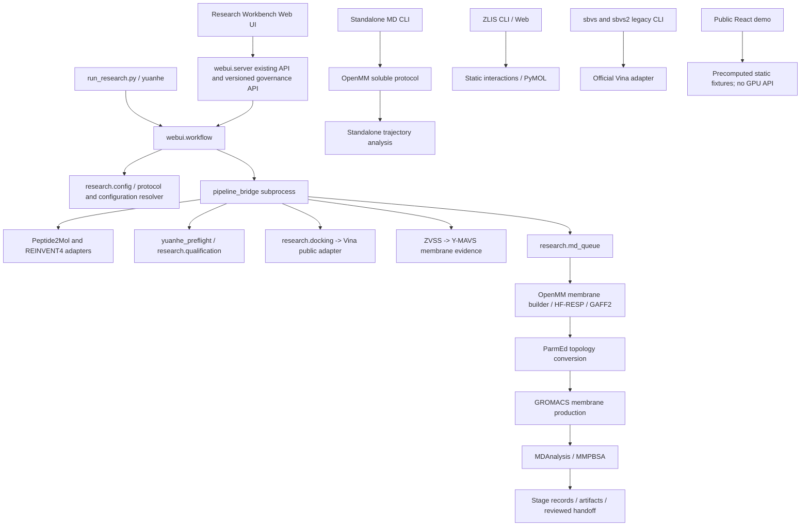

# Dependency graph

`research` implements budget, identity, qualification, orchestration and queues; `scientific` implements membrane construction/execution/analysis and portable handoffs; `modules/automation` is the standalone OpenMM workflow. They are not interchangeable layers. Existing `webui.jobs`, docking schedulers and GPU queue have different persistence and lease boundaries. Preserve them until a cross-process scheduling migration is validated.

Full AST imports and subprocess/environment records are in `tracked_file_audit.json`. Dynamic paths include runtime.json, configured Python interpreters, Vina/GROMACS executables, reviewed receptor paths, model directories, result bundles and source-revision exceptions. File checksums do not prove dynamic third-party behavior.
