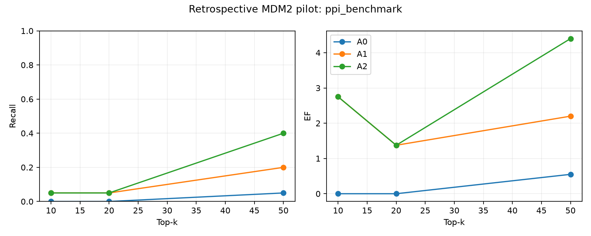
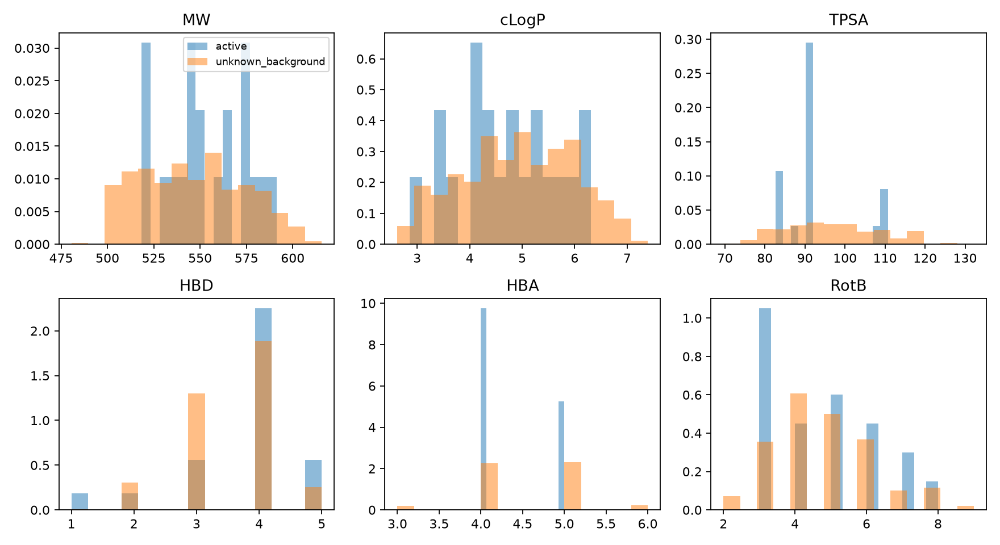

# MDM2–p53 虚拟筛选验证：pilot实际结果

冻结完整库 **550** 个唯一母体（**20** 个有直接靶点实验证据的活性分子、**530** 个未知背景）。实际Vina成功 **549** 个，通过最佳姿势立体质检 **547** 个；其余仍计入评价分母。分析报告生成耗时 **122.7分钟**，从最初环境检查起计，包含修订与作废批次。

本次是回顾性回收pilot，不是新药发现。技术质检协议在解盲前修订，但最终输出姿势质检规则晚于原始对接，因此不宣称完全前瞻预注册验证。主结果固定采用 **ppi_benchmark / A1**，不能用其他实验臂或产品规则替代。

|核心问题|本次实际结果|
|---|---|
|Nutlin-3a|排名 201；未进入Top-50|
|SAR405838|排名 304；未进入Top-50|
|Brigimadlin|排名 297；未进入Top-50|
|真实活性回收|A1 Top-50：4/20，Recall=20.0%，EF=2.20|
|肽特征相对无肽基线|A0命中1，A1命中4；Recall@50差值+15.0个百分点|
|扰动对照|A2命中8；A1相对A2差值-20.0个百分点|
|产品交付|current_product受真实风险/可获取性证据门控约束；不能用PPI研究回收结果冒充产品通过|

**验收判定：核心参考回收未通过，多肽特异性增益未获证明。** 三个参考分子均未进入Top-50；A1虽优于A0，但低于合理扰动对照A2。完整550个母体也未全部完成计算，产品合格链仍缺少证据。单种子、单次回顾性实验不能证明可泛化增益。刚性1YCR受体没有覆盖诱导契合，单状态和单构象也不能代表完整化学状态空间。

## 已修复与尚存问题

- 已修复：来源E/Z信息在互变异构枚举中丢失；部分初始三维构象与指定构型不一致；受体末端OXT准备兼容性；工作台对官方Vina版本前缀的识别。
- 最终549个可准备分子均通过来源构型及实际三维坐标反推构型核验。一个母体仍无法完成三维准备，另有2个母体的最佳对接姿势构型质检失败；均未删除或替换，保留在全部指标分母中。对接后失败数见指标和逐阶段记录。
- 后处理只对每个母体预先选定的最低Vina分数姿势作统一构型检查；失败即剔除该母体，不用次优姿势救回。相同规则用于所有活性和背景、所有实验臂。
- 科学实现51项相关回归测试、UI盲法与下载保护2项测试通过；这些工程测试与实际Vina及回收结果分别记录。
- 现有UI已经接入实时进度、双配置/三实验臂指标、参考分子排名及报告下载。此次计算由仓库CLI发起；尚未实现整套验证从UI一键启动/续跑。
- 此部署范围为本次虚拟筛选与工作台。大规模生成模型、MD及其他未调用模块没有做完整运行验收；MD默认参数未修改。

## 结构与数据核查补充

1YCR正式受体观测重原子坐标保持不变（核验RMSD 0.0 Å）。5Z02、5TRF、8PWC只用于身份核查/独立解释，没有使用这些小分子共晶坐标指导正式搜索。5Z02结构条目引用仍为“To be published”，没有可核实的该结构论文DOI；Nutlin-3a活性依据来自另有原始论文的Figure1b，未虚构结构论文。
参考活性原始依据：[Nutlin-3a与SAR405838原始论文](https://pmc.ncbi.nlm.nih.gov/articles/PMC4247201/)，[17个稳定D系列原始论文](https://pmc.ncbi.nlm.nih.gov/articles/PMC4281096/)，[Brigimadlin原始论文](https://pmc.ncbi.nlm.nih.gov/articles/PMC11612618/)。逐条来源、实验类型和数值见assay_evidence.csv。
性质匹配最大绝对标准化均差约0.383（TPSA），属于有残余差异的匹配；不是完全相同的性质分布。17/20活性来自同一研究系列，骨架分层回收见scaffold_recall.csv，不能据此宣称广泛化学空间泛化。

## 完整审计明细

本次因解盲前技术质检协议修订，标记为pilot。实际耗时 **122.7分钟**。冻结库 **550** 个唯一母体，其中真实活性 **20** 个，未知背景 **530** 个；实际Vina成功 **549** 个，通过最佳姿势立体质检 **547** 个；姿势质检失败 **2** 个。

这是回顾性混库回收验证，不是新分子发现。背景没有实验阴性标签；未计算ROC-AUC/PR-AUC。

前期版本在解盲前分别发现互变异构处理丢失E/Z构型和12个三维构象未保留指定构型，原始记录保留。正式版本保留来源互变异构形式、只作pH7.4处理，并从实际三维坐标反推构型核验；不合格构象统一采用ETKDGv3/MMFF94s重新生成，再次失败则保留失败记录。另外，统一剔除最佳对接姿势发生构型翻转的母体，保留其完整评价分母，不用次优姿势替代。该技术质检规则在标签解盲前冻结，但发生于原始对接之后，因此标记pilot，不宣称完全前瞻预注册。没有按活性标签改变处理。最终v4分析复用严格满足Vina输入字节和全部对接参数完全相同的549个真实计算结果；其原始v3计算批次复用了210个一致的旧结果，并新计算339个；未按参考排名调参。总耗时包含旧版审计与作废计算。

## 参考分子结果

|配置|实验臂|分子|最终排名|首次淘汰阶段|
|---|---|---|---:|---|
|current_product|A0|SAR405838|无排名|acquisition_filter|
|current_product|A0|Brigimadlin|无排名|acquisition_filter|
|current_product|A0|Nutlin-3a|无排名|acquisition_filter|
|current_product|A1|SAR405838|无排名|acquisition_filter|
|current_product|A1|Brigimadlin|无排名|acquisition_filter|
|current_product|A1|Nutlin-3a|无排名|acquisition_filter|
|current_product|A2|SAR405838|无排名|acquisition_filter|
|current_product|A2|Brigimadlin|无排名|acquisition_filter|
|current_product|A2|Nutlin-3a|无排名|acquisition_filter|
|ppi_benchmark|A0|SAR405838|245|保留|
|ppi_benchmark|A0|Brigimadlin|230|保留|
|ppi_benchmark|A0|Nutlin-3a|364|保留|
|ppi_benchmark|A1|SAR405838|304|保留|
|ppi_benchmark|A1|Brigimadlin|297|保留|
|ppi_benchmark|A1|Nutlin-3a|201|保留|
|ppi_benchmark|A2|SAR405838|235|保留|
|ppi_benchmark|A2|Brigimadlin|353|保留|
|ppi_benchmark|A2|Nutlin-3a|265|保留|

## 完整库指标

|配置|臂|k|命中|Recall@k|EF@k|
|---|---|---:|---:|---:|---:|
|current_product|A0|10|0|0.000|0.000|
|current_product|A0|20|0|0.000|0.000|
|current_product|A0|50|0|0.000|0.000|
|current_product|A1|10|0|0.000|0.000|
|current_product|A1|20|0|0.000|0.000|
|current_product|A1|50|0|0.000|0.000|
|current_product|A2|10|0|0.000|0.000|
|current_product|A2|20|0|0.000|0.000|
|current_product|A2|50|0|0.000|0.000|
|ppi_benchmark|A0|10|0|0.000|0.000|
|ppi_benchmark|A0|20|0|0.000|0.000|
|ppi_benchmark|A0|50|1|0.050|0.550|
|ppi_benchmark|A1|10|1|0.050|2.750|
|ppi_benchmark|A1|20|1|0.050|1.375|
|ppi_benchmark|A1|50|4|0.200|2.200|
|ppi_benchmark|A2|10|1|0.050|2.750|
|ppi_benchmark|A2|20|1|0.050|1.375|
|ppi_benchmark|A2|50|8|0.400|4.400|

所有Recall分母均为冻结库全部活性分子，包括准备失败、被过滤或未完成者。EF=(命中数/k)/(全部活性数/全部母体数)，不足k的空名额视为未命中。

## 两套配置的含义

current_product调用现有风险规则和可购买/合成证据门控。未提供有效供应目录及逆合成模型，不能生成产品合格结果。原项目MW 180–500为配置中的偏好，并非当前执行路径的硬过滤；因此不虚报Nutlin-3a被MW规则删除。
ppi_benchmark采用预先固定的MW 150–800、cLogP -1–7.5、TPSA≤180、RotB≤18、HBD≤6、HBA≤15、电荷-2至+2；风险和可获取性仍记录。研究范围不是通用开发标准。根目录scientific_top50为ppi_benchmark/A1；deliverable仍必须通过真实产品证据门控。

## 结构、盲法和计算

正式受体仅来自1YCR；按UniProt实体映射分离MDM2与p53，从肽接触重原子确定搜索盒后移除多肽。Phe19、Trp23、Leu26界面检查见target_audit.json。补建末端OXT，不改变已观测重原子坐标。5Z02、5TRF、8PWC及CCD仅用于独立身份核查和解释，其共晶坐标不用于配体3D或搜索盒。
所有分子统一标准化、盐片段处理、保留来源互变异构形式、pH7.4酸碱状态枚举与固定规则选一状态、ETKDG/MMFF94s三维化、Meeko PDBQT。SAR405838的7HC描述缺少环己醇相对立体化学，已与原始Figure1a及CHEMBL2381408交叉核验。
筛选代码只读匿名ID、结构及计算属性；排序后封存anonymous_rankings.json，再打开evaluation/labels.json。冻结文件、源代码与软件哈希见inputs/preregistered_protocol.json。
Vina 1.2.7，exhaustiveness=8，num_modes=5，seed=20261023；5个worker×4 CPU。GPU不参与标准Vina。GPU遥测可能显示100%利用率但0 MiB显存且无可见GPU进程，该异常不能归因于本次CPU计算，独立记录见evaluation/gpu_telemetry_audit.json。A0按Vina排序，A1按既有多肽残基接触召回再按Vina排序，A2对接触原子作限定刚体扰动后同样排序；三组复用同一最佳Vina姿势、同一计算预算和Top-k名额。
A2保持特征数量、元素类型及内部距离，位置在盒内并排除严重重叠；参数由几何条件确定，未按测试排名调参。同时导出RDKit原子化学规则识别的芳香、疏水、供受体等药效团描述及其A2刚体扰动坐标。描述用于界面解释，排名仍为现有距离接触指纹；不能宣称完整化学药效团模型已获性能验证。

实际CPU配额22核；并发5×4线程。正式批次整个容器平均使用18.50核（配额利用率84.1%），峰值内存5.71 GiB。初始独立50分子预检成功50/50，墙钟188.2秒，平均单分子16.6秒。该预检使用修订前状态策略，只作为CPU吞吐估计。GPU遥测异常已单独保存，不能据此宣称GPU参与Vina。

## 实验依据与边界

17个稳定D系列分子：原始J Med Chem 2014 Table6，DOI 10.1021/jm501541j，human MDM2(1–118)竞争FP Ki；逐条核对ChEMBL3380268与compound_record，排除不稳定C异构体。
Nutlin-3a Ki=43.6 nM、SAR405838 Ki=0.88 nM：Cancer Res原始Figure1b，DOI 10.1158/0008-5472.CAN-14-0799。Brigimadlin生化IC50=2 nM：原始Supplementary TableS4及Methods p2，DOI 10.1158/1535-7163.MCT-23-0783；GST-MDM2(23–117)，不是细胞实验。
17/20活性来自同一研究系列，因此属于限定化学空间的回顾性验证；不能据此推断广泛骨架泛化。性质匹配诊断见evaluation/matching_diagnostics.json；匹配并非证明背景无活性。单种子仅支持本次点估计比较，不能证明稳定、可泛化的肽引导增益。

## 验收与问题

逐项机器可读验收判定见metrics.json的engineering_acceptance；不以单个成功条目替代整体判定。
已实际运行：结构实体解析、肽界面提取、匿名库准备、50分子吞吐预检、真实CPU Vina、共享姿势三组重排、两套规则审计与完整分母评价。是否成功回收和是否优于对照，应以上表为准。
尚未验证：独立系列/多种子泛化、实验命中率、完整药效团功能等价、真实采购或合成可行性。未运行MD、MM/PBSA或FEP，未改变现有MD默认值。
20个活性分子在研究配置中均通过准备、对接和姿势质检，并获得排名；产品配置的20个活性全部在acquisition_filter首次被剔除，三个参考分子同样如此。1个准备失败和2个最佳姿势质检失败均为背景分子。各阶段活性淘汰数见metrics.json，逐分子路径见molecule_stage_ledger.csv，骨架分层见scaffold_recall.csv。原始姿势、命令、失败记录及哈希均保留，可断点续跑，不重复已成功且身份一致的计算。

## 复现

Git commit: `9a383b2ce2e96a6a68e9f46726b1d8557b92486e`。配置冻结时间：2026-10-22T19:17:40.956266+00:00。
在同一安装环境依次运行`python yuanhe benchmark run --root RUN_ROOT`和`python yuanhe benchmark evaluate --root RUN_ROOT`；冻结哈希不符将拒绝执行。复制到其他目录需保存原始证据并创建明确的新运行清单，不能静默改写冻结路径。
原始结构：https://www.rcsb.org/structure/1YCR；参考5Z02/5TRF/8PWC。原始文献和来源哈希位于evaluation/literature、assay_evidence.csv。
